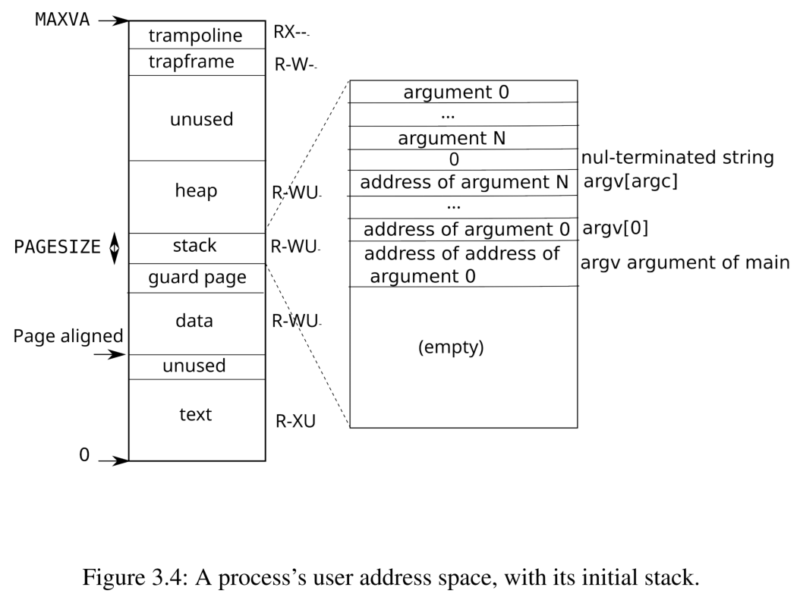
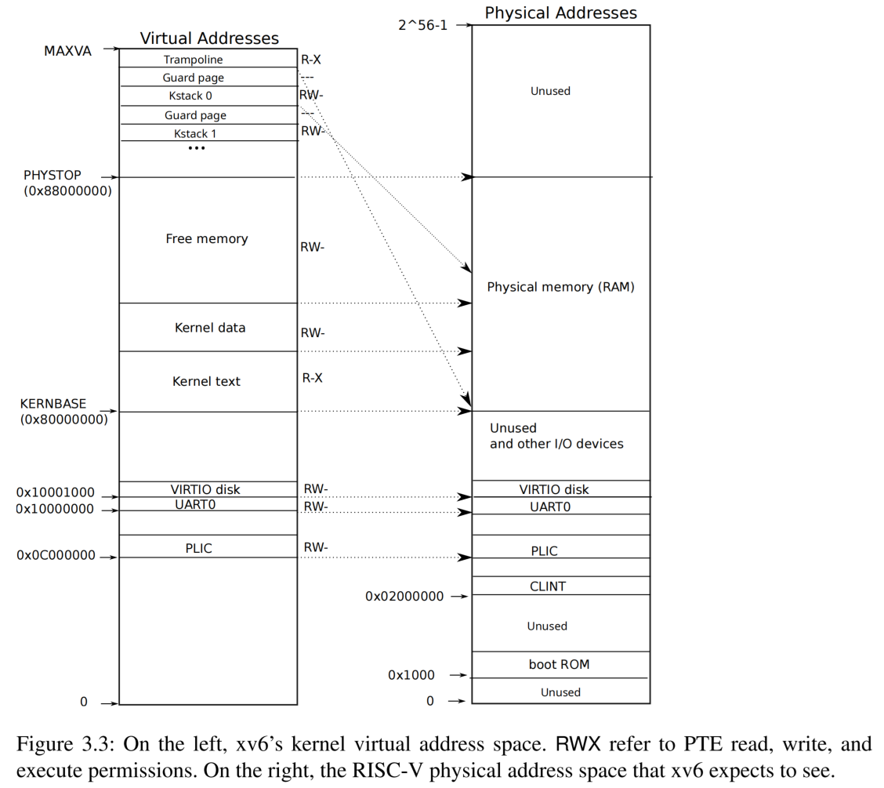

---
title: "MIT6.828 Lab: Copy-on-Write Fork for xv6"
description: "My Recording for completing MIT6.828 Lab: Copy-on-Write Fork for xv6"
pubDatetime: 2026-10-23T18:00:00+08:00
tags:
  - os
  - xv6
featured: false
draft: false
---
## Table of Contents

## 问题

如果父进程的内存占用较大，`fork()`时的复制会耗费大量时间。并且很多时候`fork`后会紧接`exec`,又再次丢弃掉复制的内存，并且通常不会使用其中的大部分内存，从而造成浪费。

copy-on-write fork，即在fork时不复制进程的全部用户内存，fork的子进程的页表表项仍指向先前的物理地址，在父进程或子进程真正需要write时再进行物理内存的分配和复制。

## 实现思路

1. 为每个物理页增加引用计数。

2. 在`fork`中不对父进程的内存进行完整复制，而是让子进程的页表表项指向和父进程相同的物理地址，并增加引用计数。并同时将父子进程的所以PTE表项的PTE_W位置0，若原始页面的PTE_W为1，则利用RSW位（PTE的第8,9位）表示该页为COW页，标志着此页可写，但写之前需要先进行内存分配。

3. 当子进程位于用户态时，若需要对某块可写但被标记为COW页的内存区域进行写操作时，由于PTE_W为0,  会触发页错误，从而中断进入`vmfault()`函数的处理。因此，在`vmfalult()`函数中，要增加对于COW页错误的处理，即若该页为COW页，需要新分配物理页面，并复制旧物理页面的内容到新页，并减少旧页的引用计数。当旧页的引用计数减为0时，需要释放对应的物理内存。


## 实现细节和遇到的一些问题

实现思路很简单，但实现起来有很多细节很麻烦...

### 关于引用计数的语义问题

```c++
int refcount[PHYSTOP/PGSIZE];
```

最开始我将引用计数的语义定义为有多少个用户页表中映射了这一物理页。

因此在`mappages()`中每对一个物理页的映射，就将该物理页的引用数目+1, 而在`uvmunmap()`中没取消对一个物理页的映射，就将该物理页的引用数目-1,并在减为0时释放对应的物理内存区域。这种想法听起来很美好，但是实现起来考量的细节很多。



我们可以将一个用户进程的内存区域分为用户内存和内核内存（这是我瞎定义的）, 例如`trapframe`和`trampoline`同属于内核内存，因为他们的所有权是属于内核的，在取消映射时并不会释放其物理内存，因为该物理内存还会被其他进程复用。而`text`, `data`, `guard page`, `stack`, `heap`这些都属于用户内存，所有权属于进程，进程销毁则这些内存也会被释放。

这就引来一个问题，如果采取先前对引用计数的定义，如何处理内核内存的语义？他们同样使用`mappages()`和`uvmunmap()`进行映射和取消映射，但是他们并不会在引用数目减为0时释放。同时`uvmunmap()`中还有`do_free`参数，用来表示取消映射的同时是否释放对应的物理内存，这一点造成了语义的更加混乱，若按照之前的定义，`do_free`的值显然不会影响引用计数的处理，那这个参数是否失去了意义？这种方式当然也有正确的处理方式，但会引入更多复杂性。

---

因此我们将引用计数定义为**所有权计数**，即该物理内存区域正被多少人持有，只有持有的人才能对这块内存进行合法的操作。

例如，调用`kalloc()`即可看作这个进程获得了对于这片物理内存的所有权，后续可以使用这片物理内存；而调用`kfree()`标志着放弃了这片物理的内存的所有权，不再拥有这片物理内存。当没有人拥有这片物理内存时，便可以对这片物理内存进行真正的释放。



在这种语义下，我们真正需要管理引用计数的实际是上图中的Free memory这段区域对应的物理内存。内核通过`kalloc`和`kfree`管理这段内存区域。无论是内核(例如内核为进程申请`trapframe`和`kstack`的内存空间)还是用户进程需要内存(`sbrk`)时，都会通过`kalloc`向这段区域申请内存。

由于`kalloc`的调用者就默认拥有了这片物理内存，因此我们在`kalloc`中将引用计数初始化为1。

```c++
void *
kalloc(void)
{
  struct run *r;

  acquire(&kmem.lock);
  r = kmem.freelist;
  if(r)
    kmem.freelist = r->next;
  release(&kmem.lock);

  if(r) {
    memset((char*)r, 5, PGSIZE); // fill with junk
    uint64 pa = (uint64)r;
    acquire(&refcount_lock);
    refcount[pa / PGSIZE] = 1; // set reference count to 1;
    release(&refcount_lock);
  }
  return (void*)r;
}
```

什么时候需要改变引用计数呢?当调用`kfork`时，内核会首先`allocproc()`，其中包含利用`kalloc`申请`trapframe`和页表的内存空间，初始化必要元信息，初始化页表。然后利用`uvmcopy()`为子进程先分配等大的内存空间，将父进程的用户内存空间(指0~`p->sz`)这段区域复制到新的子进程中。

所以我们首先需要修改`uvmcopy()`，让子进程不再拥有新的物理内存区域，而是让其拥有父进程的内存区域。我们只需要让其页表指向父进程所指向的物理内存，并将父子进程可写页的`PTE_W`表项置0,`PTE_COW`表项(定为PTE的第8位)置1，其他权限保持不变，同时，将**对应物理页的引用计数+1***即可。关键是注意错误处理,失败后父进程需要恢复原来状态，以及引用状态更新和实际表项更新的一致性问题。

```c++
int
uvmcopy(pagetable_t old, pagetable_t new, uint64 sz)
{
  pte_t *pte;
  uint64 pa, i;
  uint flags;

  for(i = 0; i < sz; i += PGSIZE){
    if((pte = walk(old, i, 0)) == 0)
      continue;   // page table entry hasn't been allocated
    if((*pte & PTE_V) == 0)
      continue;   // physical page hasn't been allocated
    pa = PTE2PA(*pte);
    flags = PTE_FLAGS(*pte);
    if(flags & PTE_W){
      // if the page is writable(indicates it's not a cow page), we need to mark it as copy-on-write.
      flags &= ~PTE_W; // clear the writable flag
      flags |= PTE_COW; // set the copy-on-write flag
    }
    if(mappages(new, i, PGSIZE, (uint64)pa, flags) != 0){
      goto err;
    }
    acquire(&refcount_lock);
    refcount[pa / PGSIZE]++;
    release(&refcount_lock);
  }

  // mark the page as copy-on-write in the parent
  for(i = 0; i < sz; i += PGSIZE){
    if((pte = walk(old, i, 0)) == 0)
      continue;
    if((*pte & PTE_V) == 0)
      continue;
    if((*pte & PTE_COW)) 
      continue;// Already marked as copy-on-write
    if(*pte & PTE_W){
      *pte &= ~PTE_W; // clear the writable flag
      *pte |= PTE_COW; // set the copy-on-write flag
    }
  }
  return 0;

 err:
  uvmunmap(new, 0, i / PGSIZE, 1);
  return -1;
}

```

这样就完成了子进程拥有某块物理内存的语义的表示，那么释放呢？

唯一释放的机会是调用`kfree()`时，只有调用`free`我们才认为它放弃了这篇内存区域的所有权。而简单的`uvmunmap`若不将`do_free`置为1,仅仅表示取消映射，标志这它没放弃这片内存区域，因为它还可以继续使用。这样语义就清晰多了，将`free`和取消映射两者区分开了。

因此，我们需要对`kfree()`进行相应修改，

```c++
void
kfree(void *pa)
{
  struct run *r;

  if(((uint64)pa % PGSIZE) != 0 || (char*)pa < end || (uint64)pa >= PHYSTOP)
    panic("kfree");

  // Fill with junk to catch dangling refs.
  acquire(&refcount_lock);
  if(--refcount[(uint64)pa / PGSIZE] == 0) {
    memset(pa, 1, PGSIZE);
    r = (struct run*)pa;

    acquire(&kmem.lock);
    r->next = kmem.freelist;
    kmem.freelist = r;
    release(&kmem.lock);
  }
  release(&refcount_lock);

}

```

每有一次调用则减少引用计数，减为0时才真正释放。

---

处理好了copy的问题，现在考虑write的情况。`vmfault()`需要正确识别这种情况。

在当前的xv6中，我们一共需要处理三种情况，分别是lazy allocate,对应情况为所访问页还没被映射的分支；cow情况, 对应与已映射，写页时发生错误，并且`PTE_COW`和`PTE_U`被标记为1；其余非法情况，例如非法内存空间的访问和权限不足的访问。

```c++
uint64
vmfault(pagetable_t pagetable, uint64 va, int read)
{
  uint64 mem;
  struct proc *p = myproc();

  if (va >= p->sz)
    return 0;
  va = PGROUNDDOWN(va);
  if(ismapped(pagetable, va)) {
    pte_t* pte = walk(pagetable, va, 0);
    uint64 pa = PTE2PA(*pte);
    if(!read && (*pte & PTE_COW) && (*pte & PTE_U)) {
      // for cow pages
      int perm = PTE_FLAGS(*pte);
      mem = (uint64) kalloc();
      if(mem == 0)
        return 0;
      memmove((void *)mem, (void *)pa, PGSIZE);
      *pte = 0;
      kfree((void *)pa);
      if (mappages(pagetable, va, PGSIZE, mem, (perm & (~PTE_COW)) | PTE_W) != 0) {
        kfree((void *)mem);
        return 0;
      }

      return mem;
    }
    return 0;
  }
  // for lazily allocated pages
  mem = (uint64) kalloc();
  if(mem == 0)
    return 0;
  memset((void *) mem, 0, PGSIZE);
  if (mappages(pagetable, va, PGSIZE, mem, PTE_W|PTE_U|PTE_R) != 0) {
    kfree((void *)mem);
    return 0;
  }
  return mem;
}

```

对于`COW`分支，我们需要让触发该页错误的进程拥有一片新的内存空间，并且释放原有内存空间的所有权。

---

最后，除了用户态可能触发页错误外，内核态对用户页的访问也可能出现页错误(`copyout()`从内核态向用户态写时, 如果正好写在`COW`页),由于是在内核态执行，并不会触发页错误进入中断，所以我们需要手动处理是否页错误。加上对于`COW`页的判断即可。

```c++
int
copyout(pagetable_t pagetable, uint64 dstva, char *src, uint64 len)
{
  uint64 n, va0, pa0;
  pte_t *pte;

  while(len > 0){
    va0 = PGROUNDDOWN(dstva);
    if(va0 >= MAXVA)
      return -1;
  
    pte = walk(pagetable, va0, 0);
    pa0 = walkaddr(pagetable, va0);
    if(pa0 == 0 || (pte != 0 && (*pte & PTE_COW) && (*pte & PTE_U))) {
      if((pa0 = vmfault(pagetable, va0, 0)) == 0) {
        return -1;
      }
    }
    // forbid copyout over read-only user text pages.
    pte = walk(pagetable, va0, 0);
    if((*pte & PTE_W) == 0)
      return -1;
      
    n = PGSIZE - (dstva - va0);
    if(n > len)
      n = len;
    memmove((void *)(pa0 + (dstva - va0)), src, n);

    len -= n;
    src += n;
    dstva = va0 + PGSIZE;
  }
  return 0;
}
```

至此，已能通过全部测试点。

### 并发问题

`refcount`属于临界区资源，多个进程可能同时对其操作。考虑一个进程`fork()`出的多个子进程，其中一个正在`exit()`，释放资源。另一个正在`fork()`，进行`uvmcopy()`操作。初始时刻某片物理内存引用计数为3。释放过程记性`refcount--`操作，复制过程进行`refcount++`操作，两者读取同一个初始值3，释放完成后写回2, 复制完成后写回4, 此时引用计数本应该为3,但最终状态却为4，造成不一致性。所以需要单独的lock对`refcount`进行保护

CPUs=1并不能因为单核就保证不出现并发问题，因为CPUs=1时总体来看仍然是多个进程并发执行，可能会出现数据竞争，需要区分清楚。

## 一点感悟

大型项目当中对于变量或者函数语义的理解，以及上下文的约定至关重要。好的语义能让程序运行状态更佳清晰，代码易于编写，也更加易懂。操作系统拥有巨大的状态空间，每个变量的每个状态表示的含义必须严格归定，并在不同的地方严格遵守，不能依靠临时起意的想法和含糊的约定，界限不清晰的地方往往就是bug滋生的地方。
